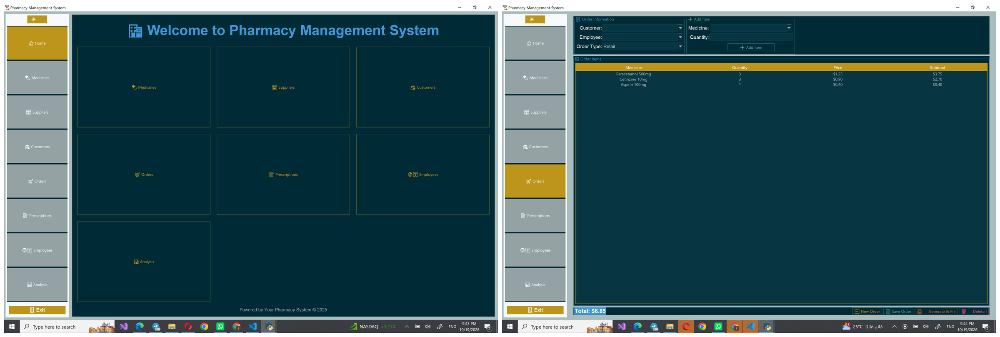
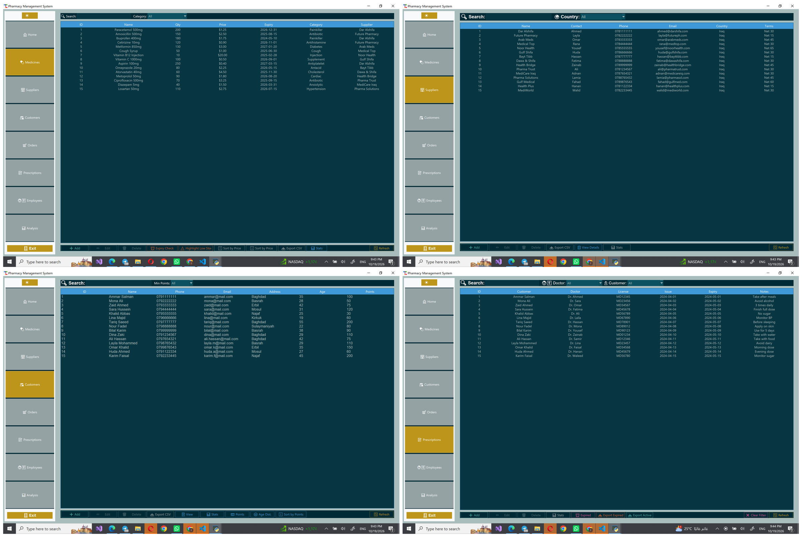
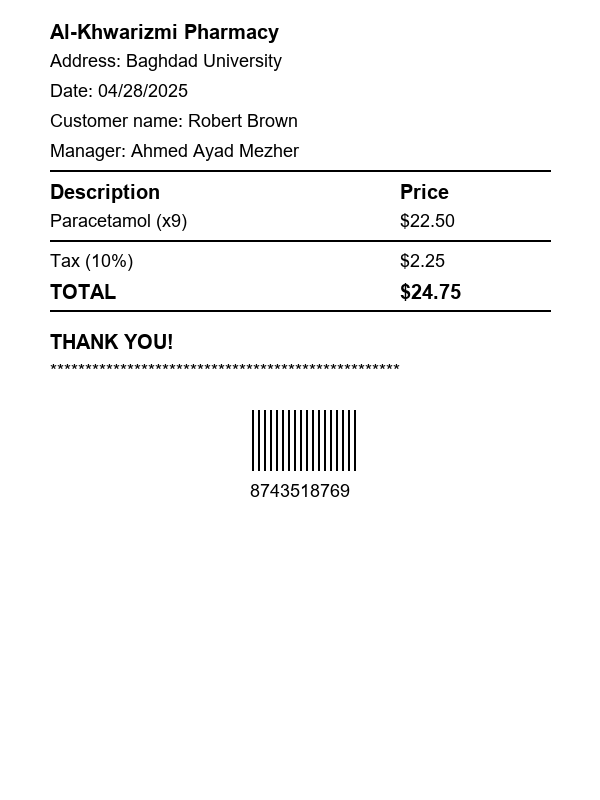
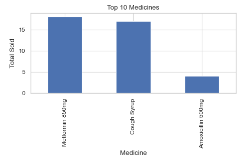
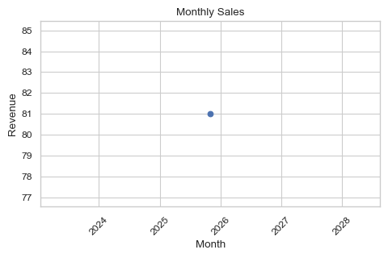

# Pharmacy Management System

A desktop application for running a pharmacy's day-to-day operations, covering inventory, suppliers,
customers, sales orders, prescriptions and staff, backed by a **MySQL** database.
Built with **Python, Tkinter and ttkbootstrap** as a university database-systems project
at Al-Khwarizmi College of Engineering, University of Baghdad.





## Features

| Module | What it does |
|---|---|
| 🔐 **Login** | Admin login screen before the app opens |
| 💊 **Medicines** | Full CRUD for medicines, category filter, **expiry check**, **low-stock highlighting**, sort by price, CSV export, statistics |
| 🏢 **Suppliers** | Supplier directory with contact person, country and payment terms |
| 👥 **Customers** | Customer records, loyalty points, age distribution, search, CSV export |
| 🛒 **Orders** | Build an order from multiple medicines, automatic stock reduction, **printable receipt** generation |
| 📝 **Prescriptions** | Prescriptions linked to customers and doctors, filters, expired/active views and CSV export |
| 👨‍⚕️ **Employees** | Staff records, salary sorting, hiring statistics |
| 📊 **Analysis** | Background data analysis with charts: top-selling medicines, monthly sales, employee performance, stock levels |
| 🌗 **Themes** | Light / dark theme toggle, remembered between sessions |

## Screenshots

<p>
  
  
  
</p>

## Database

The schema in [`schema.sql`](schema.sql) contains 9 related tables with foreign-key constraints
and sample data:

```
suppliers ──< medicines >── stock
                 │
customers ──< orders ──< order_items >── medicines
    │            └── employees
    └──< prescriptions ──< prescription_items >── medicines
```

## Getting started

**Requirements:** Python 3.9+ and a MySQL / MariaDB server (e.g. XAMPP).

```bash
git clone https://github.com/ahmedayadeng-lang/pharmacy-management-system.git
cd pharmacy-management-system
pip install -r requirements.txt

# Create the database, tables and sample data
mysql -u root -p < schema.sql

python main.py
```

Default login: **username `ahmed`, password `123`** (set in `logintoapp.py`).

By default the app connects to `root@localhost` with an empty password. To use different
credentials, set these environment variables:
`PHARMACY_DB_HOST`, `PHARMACY_DB_USER`, `PHARMACY_DB_PASSWORD`, `PHARMACY_DB_NAME`.

## Project structure

```
├── main.py                  # Entry point: theme loading, login, main window
├── logintoapp.py            # Admin login window
├── pharmacy_app.py          # Main window: sidebar navigation, theme toggle
├── main_screen.py           # Home dashboard
├── database.py              # MySQL connection pool + model classes (Medicine, Customer, Order, ...)
├── medicine_manager.py      # Medicines module
├── supplier_manager.py      # Suppliers module
├── customer_manager.py      # Customers module
├── order_manager.py         # Orders + receipt generation
├── prescription_manager.py  # Prescriptions module
├── employee_manager.py      # Employees module
├── data_analysis.py         # Analysis window and charts
├── dialog.py                # Reusable add/edit form dialog
├── style_manager.py         # Light/dark colour definitions
├── sales_manager.py         # Sales module (standalone, not wired into the main window)
├── stock_manager.py         # Stock module (standalone, not wired into the main window)
└── schema.sql               # Database schema + sample data
```

## Tech stack

Python · Tkinter · ttkbootstrap · MySQL · pandas · Matplotlib · seaborn · Pillow
